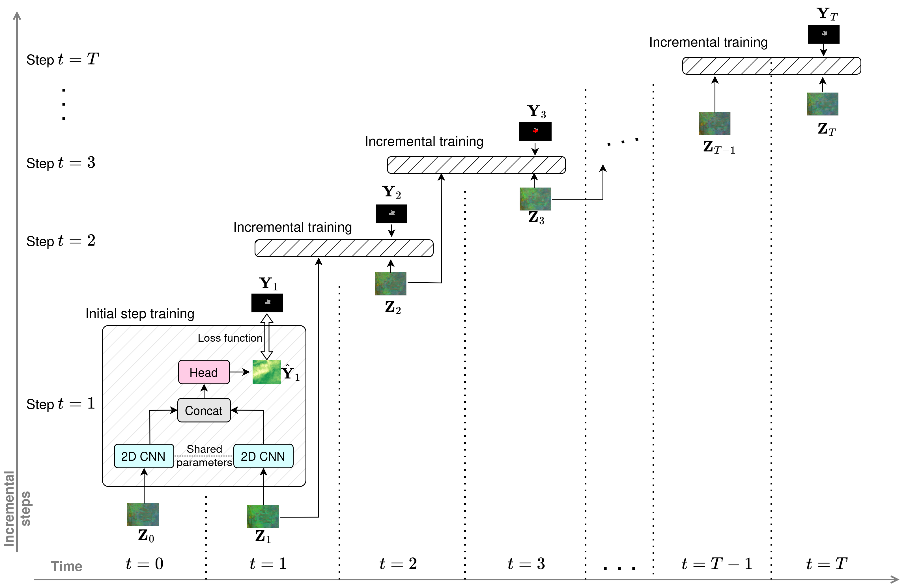

# Temporal-Incremental Continual Learning for Forest Disturbance Monitoring




The previous image illustrates our temporal-incremental continual learning (**TICL**) setup for forest disturbance monitoring (image-wise change detection). The objective is to update a deep learning model each time new labeled data (years in our case) is available for training.


> [!NOTE]  
> The reference data used in this study comes from the [FORWARDS](https://forwards-project.eu/) project, which will be publicly released. The input data used in this study comes from publicly available AlphaEarth embeddings at [Google Earth Engine](https://developers.google.com/earth-engine/datasets/catalog/GOOGLE_SATELLITE_EMBEDDING_V1_ANNUAL).


## Training

The Continual Learning (CL) pipeline is separated into first step training, and incremental training.  We provide config file examples on how to train our model with different settings.

* Example for the first step training in the Agresta dataset with the corresponding config file
```
python train_initial.py -s config/first_step/agresta.yaml
```

* Example for the incremental training with CL methods (fine tuning, elastic weight consolidation, learning without forgetting, modular network, and replay-based strategy) linked to the **first-step version *X***
```
python train_inc.py -s config/algo/agresta_fine -v X
python train_inc.py -s config/algo/agresta_ewc -v X
python train_inc.py -s config/algo/agresta_lwf -v X
python train_inc.py -s config/algo/agresta_modular -v X
python train_inc.py -s config/algo/agresta_replay -v X
```

* Example for the references methods: concatenation of all data samples, and fresh (random start and train in particular step) 
```
python train_inc.py -s config/base/agresta.yaml -v X
```


## Evaluation

* To evaluate the CL method in each of the incremental steps it was trained on:
```
python eval_inc.py -s config/eval.yaml
```
All details to folder paths and configurations are inside the yaml files.


## Installation
For install the proper conda enviroment run the following command:
```
conda env create -f environment.yml
```


---
